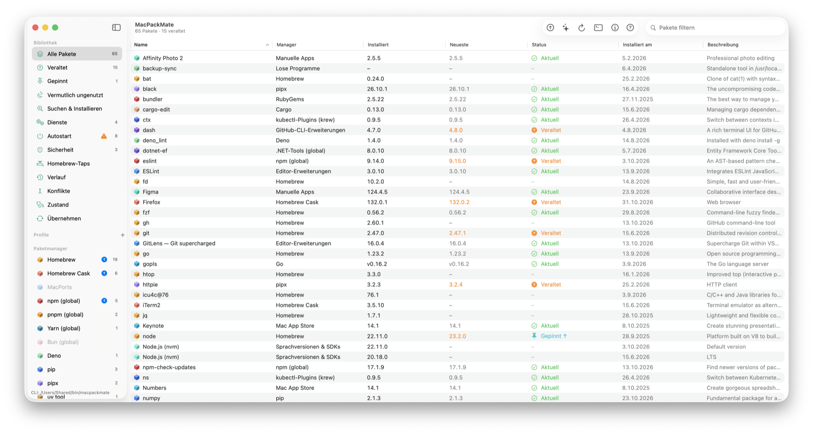
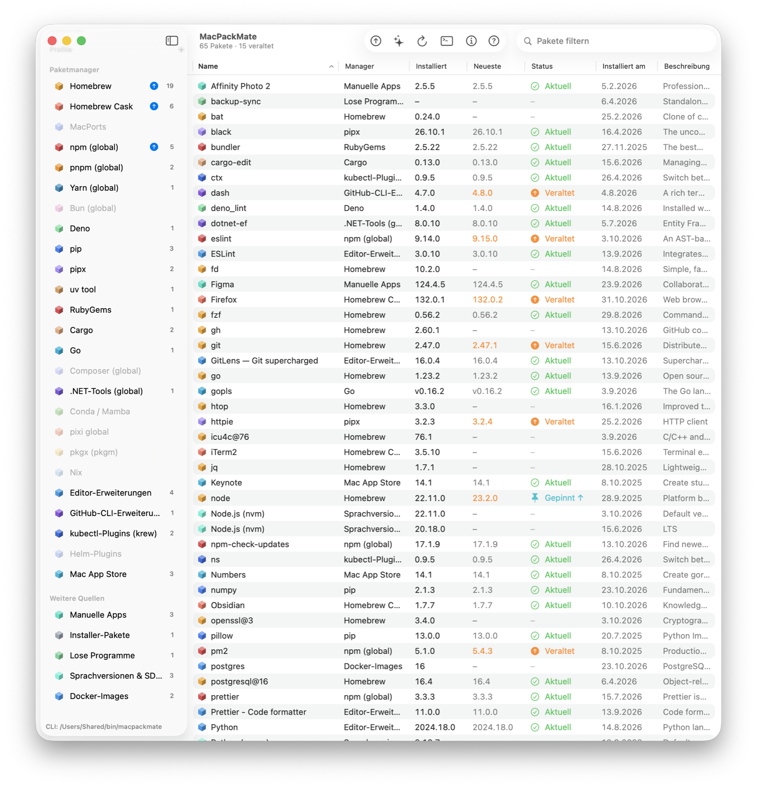
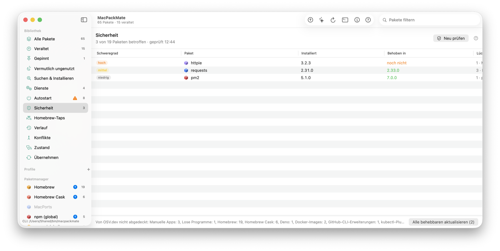
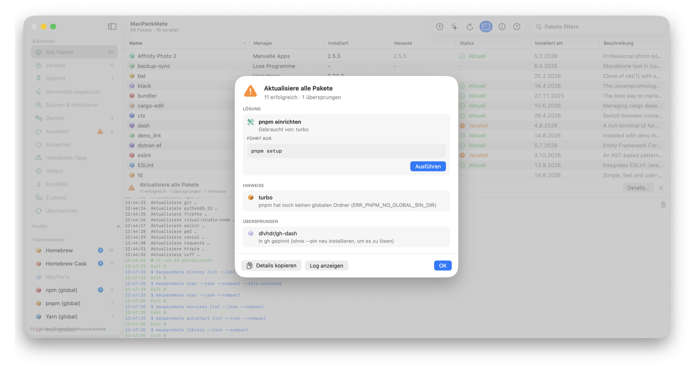

# homebrew-tap

Homebrew tap for **[MacPackMate](https://dynamo.at/macpackmate/)** by Flo Murnig ([dynamo.at](https://dynamo.at)).

*Deutsche Kurzfassung am Ende.*

<picture>
  <source media="(prefers-color-scheme: dark)" srcset="img/app-window-dark.png">
  
</picture>

## Install

```sh
brew tap flo-murnig/tap
brew install --cask macpackmate
```

This installs `MacPackMate.app` into `/Applications` and links the command-line tool `macpackmate` into your `PATH`.

```sh
brew upgrade --cask macpackmate           # update (the app also updates itself via Sparkle)
brew uninstall --cask macpackmate         # remove
brew uninstall --zap --cask macpackmate   # also remove settings, history, caches and the background check
```

Requires macOS 14 Sonoma or newer (Apple Silicon or Intel). The app is signed with a Developer ID and notarized by Apple.

## What is MacPackMate?

One hub for every package manager and install source on your Mac. MacPackMate scans them all in parallel and shows everything in a single list – then lets you search, install, update, roll back and remove from one place. It is a native SwiftUI app **and** a command-line tool, in English and German.

**Sources:** Homebrew (formulae and casks), MacPorts, npm, pnpm, Yarn, Bun, Deno, pip, pipx, uv, RubyGems, Cargo, Go, Composer, .NET tools, Conda/Mamba, pixi, pkgx, Nix, GitHub CLI extensions, kubectl (krew) and Helm plugins, editor extensions (VS Code, Cursor, VSCodium, Windsurf), Mac App Store, manually installed apps, installer packages, loose binaries, language versions and SDKs (nvm, fnm, Volta, pyenv, rbenv, asdf, mise, SDKMAN!, JDKs) and Docker images.

**Highlights**

- Search all package managers at once; install a specific version, switch back, or roll back after an update
- Adopt manually installed apps into Homebrew casks
- Security check against OSV.dev (on demand; only public package names and versions are sent)
- Homebrew background services, login items (LaunchAgents/Daemons), `PATH` and command conflicts with guided fixes
- Daily background check with notifications and a menu bar icon
- Full history with logs, notes and profiles, backup and restore via a single pack file (also Brewfile import/export) – ideal for setting up a new Mac
- Admin rights without stored passwords; no telemetry
- Detailed manual with 28 chapters (in the app with ⌘?, or `macpackmate guide`)

### Screenshots

Real app, neutral demo data.

<picture>
  <source media="(prefers-color-scheme: dark)" srcset="img/app-sources-dark.png">
  
</picture>

<picture>
  <source media="(prefers-color-scheme: dark)" srcset="img/app-security-dark.png">
  
</picture>

<picture>
  <source media="(prefers-color-scheme: dark)" srcset="img/app-results-dark.png">
  
</picture>

```sh
macpackmate                                # scan everything
macpackmate scan --outdated-only
macpackmate search ripgrep
macpackmate update --all --dry-run
macpackmate export -o MacPackMate.json     # back up your Mac
```

## Trial and license

MacPackMate is fully usable for 14 days. After that it runs in read-only mode (scanning, searching and dry runs keep working); installing, updating and removing need a license. One license key covers up to three Macs and all updates.

**Website, screenshots, download and purchase: [dynamo.at/macpackmate](https://dynamo.at/macpackmate/)**

## Maintainer note

The cask lives in [`Casks/macpackmate.rb`](Casks/macpackmate.rb) and points to the notarized DMG on `dynamo.at`; `livecheck` reads the Sparkle appcast at `https://dynamo.at/macpackmate/appcast.xml`.

---

## Deutsch

MacPackMate ist ein zentraler Hub für alle Paketmanager und Installationswege auf dem Mac – native SwiftUI-App und Befehlszeilen-Tool, auf Deutsch und Englisch. Alles wird parallel gescannt und in **einer** Liste gezeigt; Suchen, Installieren, Aktualisieren, Zurückgehen und Entfernen geht von dort aus.

Installation: siehe oben (`brew tap flo-murnig/tap` und `brew install --cask macpackmate`). Voraussetzung ist macOS 14 oder neuer. 14 Tage voll nutzbar, danach Lesemodus; ein Lizenzschlüssel gilt für bis zu drei Macs und alle Updates.

Webseite, Screenshots, Download und Kauf: **[dynamo.at/macpackmate](https://dynamo.at/macpackmate/)**
